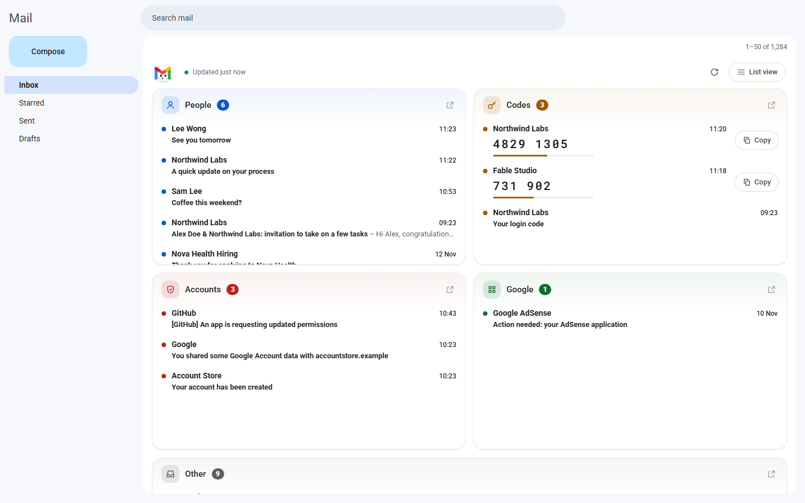
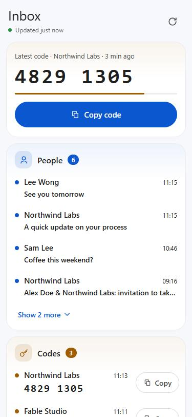
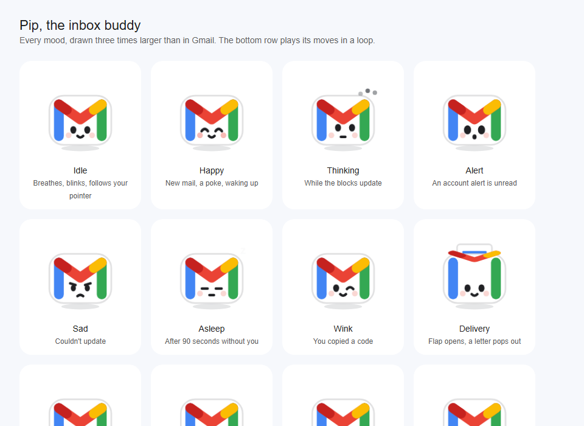

# Inbox blocks

Your Gmail home page, split into five blocks, so you know where to look the moment you open it.

| Block | What lands there |
|---|---|
| **People** | Mail written by a person, messages forwarded by LinkedIn, Upwork and similar, files shared with you, and replies from companies you applied to |
| **Codes** | One-time codes. The code is shown in the block, so you can copy it without opening the mail |
| **Accounts** | Sign-in alerts, password changes, apps asking for access, new accounts |
| **Google** | Mail from Google services (Search Console, AdSense, Cloud, Play…) |
| **Other** | Newsletters, promotions, job alerts, bills, orders. Folded away at the bottom |



<p align="center"></p>

*Screenshots use made-up mail.*

## How it works

- **A Google Apps Script** in your own Google account sorts new mail every 10 minutes and gives each message a `Sorted/…` label. It reads only the headers and preview text, and never deletes anything.
- **A Chrome extension** draws the blocks on the Gmail inbox page. It gets its data from the script, which you publish as a web app that only you can open.
- **A phone page**: the same web app link opened on your phone shows the blocks as a page you can add to your home screen.

There is no server in between. Everything runs in your Google account and your browser.

The look stays close to Gmail: neutral colours, Gmail's fonts, light and dark themes. Motion is small and has a job to do:
- new mail glows briefly when it arrives;
- unread counts bump when they change;
- each code shows how fresh it is;
- the blocks rise in gently.

Reduced-motion settings are respected.

## Meet Pip

Pip is a cute take on the Gmail "M". It lives in the top corner of the blocks, and its moods follow your inbox:



| When | Pip |
|---|---|
| The blocks are updating | thinks, with three bouncing dots |
| New mail arrives | the flap lifts, a letter peeks out, sparkles and a hop, plus a bubble naming the sender |
| An account alert is unread | looks surprised, its badge turns red and it shakes now and then |
| You copy a code | winks |
| Something fails | frowns |
| You've been away for 90 seconds | naps (zz…), then stretches awake when you're back |
| Any other time | breathes, blinks, follows your pointer with its eyes, and now and then looks around, hops, wiggles or spins |

The small badge on Pip's corner shows what matters most right now: red for account alerts, yellow for a fresh code, blue for mail from people. Click Pip for a one-line summary.

If your computer asks apps to reduce motion, Pip only blinks and changes face. Turn on **Always animate** in the settings to see everything.

*The Gmail logo is a trademark of Google LLC. Pip is a fan-made drawing inspired by it; this project is not affiliated with Google.*

## Install

About 15 minutes, once.

### 1. The script
1. Open [script.google.com](https://script.google.com) → **New project**, and name it `Inbox sorter`.
2. In **Project Settings**, tick **Show "appsscript.json" manifest file in editor**.
3. In the editor, create these files and paste in their contents from this repo:

   | In the editor | From |
   |---|---|
   | `appsscript.json` (replace) | [`apps-script/appsscript.json`](apps-script/appsscript.json) |
   | `Code.gs` (replace) | [`apps-script/Code.gs`](apps-script/Code.gs) |
   | **+ → Script** `Classifier` | [`apps-script/Classifier.gs`](apps-script/Classifier.gs) |
   | **+ → Script** `WebApp` | [`apps-script/WebApp.gs`](apps-script/WebApp.gs) |
   | **+ → HTML** `Phone` | [`apps-script/Phone.html`](apps-script/Phone.html) |

4. Select the `setup` function → **Run**. Allow access when Google asks. *"Google hasn't verified this app"* appears because this is your own script: choose **Advanced → Go to Inbox sorter**.

   A big inbox is sorted over several runs. The log says so, and the rest continues by itself.

### 2. The web app
**Deploy → New deployment → ⚙ → Web app**, with **Execute as: Me** and **Who has access: Only myself**. Copy the **Web app URL** (it ends in `/exec`).

### 3. The Chrome extension
1. Open `chrome://extensions` and turn on **Developer mode**.
2. Choose **Load unpacked**, then select the [`extension`](extension) folder.
3. Click the extension's icon. Paste the web app URL and press **Save and test**.
4. Reload Gmail.

### 4. On your phone (optional)
1. Open the same web app URL on your phone, signed in to the same Google account. The settings page has a **Copy phone link** button.
2. Use **Add to Home Screen**.

On Android, you can also turn on **Label notifications** for `Sorted/People` and `Sorted/Security` in the Gmail app. Then your phone only buzzes for mail that matters.

## Using it

- **Open a mail:** click it. Going back to the inbox brings the blocks back.
- **Open a whole block in Gmail:** the ↗ button in the block's corner.
- **Codes:** press **Copy**. Codes older than a day fold into *Earlier*.
- **Back to Gmail's own list:** **List view** at the top right switches between the blocks and Gmail's list.
- **Wrong block?** Move the mail to the right `Sorted/…` label in Gmail, on the web or the phone. The script learns the sender within 10 minutes.
- **Clean my inbox automatically** (in the extension settings) moves automated mail out of the inbox:
  - job alerts, newsletters and Google news right away;
  - codes after 30 minutes;
  - bills and orders after 3 days.

  Nothing is deleted, and starred mail always stays.

## Updating

After you change a `.gs` or `.html` file in Apps Script, publish a new version of the web app. The URL stays the same:

**Deploy → Manage deployments → ✏️ → Version: New version → Deploy**

After you change the extension, press the reload button on its card in `chrome://extensions`.

## Development

```bash
node test/classifier.test.js
```
Checks 61 sample mails against the sorting rules.

```bash
node test/sim.js --preview
```
Runs the whole script against a fake Gmail: sorting, learning from your moves, auto-clean, the blocks data, code reading, Gmail rate limits and unreadable mail. It also writes preview data.

To preview the UI without Gmail, run `python -m http.server 8765` in this folder and open:
- `http://localhost:8765/preview/blocks.html#inbox` (add `?dark` before the `#` for the dark theme)
- `http://localhost:8765/preview/phone.html`
- `http://localhost:8765/preview/pip.html` (every mood of Pip)

```
apps-script/   Classifier.gs (rules) · Code.gs (sorting) · WebApp.gs (data, settings, phone page) · Phone.html
extension/     content.js (the blocks) · pip.js (the mascot) · background.js · options page
test/          classifier.test.js · sim.js (fake Gmail)
preview/       local preview pages
docs/          screenshots
```

## Limits

- The blocks need Chrome or another Chromium browser (Edge, Brave…) on a computer. The Gmail app on a phone can't be changed; use the phone page instead.
- The blocks show the 200 newest messages in your inbox.
- Sorting is rule-based: senders, subjects and bulk-mail signals. When it isn't sure, mail goes to **People**: an extra mail there is better than missing one from a person.
- A free Gmail account allows a limited number of API calls per day. A very large inbox may take a day to sort the first time.

A Vietnamese install guide is in [HUONG-DAN.md](HUONG-DAN.md).
